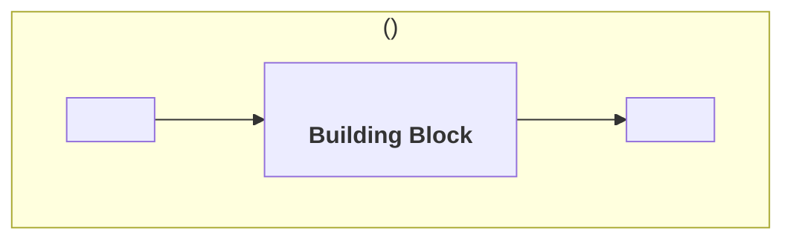
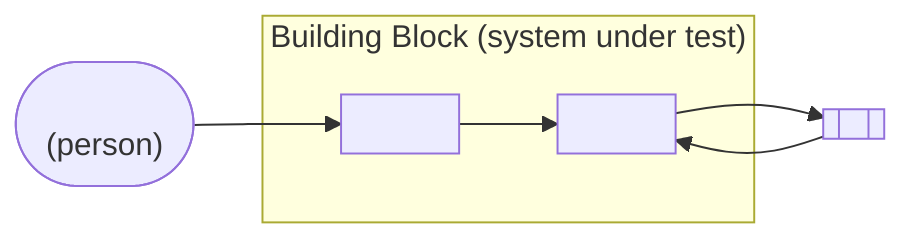

<!--
How to fill this file: see the Specification Framework, chapter "Introductory Chapters" (chapters/introductory_chapters.md). A complete worked example is in resources/examples/wallet/introduction/overview.md of the same repository.

The overview describes the Building Block. Its content comes from the Working Group's preparatory work: it publishes the result of that work, it does not derive it. If a section cannot be filled, the preparatory work is probably incomplete.

Replace every <placeholder> and delete every comment before publication. Do not write requirements, product names or vendor names in this file.
-->

# Overview

## Purpose

### Value

<!--
Answer four questions in one to three paragraphs:
1. What problem does this Building Block solve, and for whom?
2. What can a government do with it that it could not do before?
3. Which capabilities does it provide? Name each as a noun phrase ("Credential Storage", not "Stores credentials"), stating what, never how.
4. What would go wrong if every government and vendor built this component to their own design? Use one or more of: interoperability, replaceability, choice, assurance.

Every capability named here must be realised by at least one functionality in the Description. If none of the four arguments in question 4 applies, the component may not need a GovStack specification.
-->

The <Building Block name> Building Block exists so that <beneficiary> can <outcome>.

Today <the problem, stated plainly>. The <Building Block name> provides **<Capability>**, **<Capability>** and **<Capability>**, so that <the changed state>.

A common specification matters here because <the interoperability, replaceability, choice or assurance argument, specific to this Building Block>.

### Place in larger systems

<!--
Place the Building Block in the systems it operates in. Name roles, not products. Place the reference architecture for the reader; do not import its content.

- The GovStack Architecture, and the cross-functional requirements the Building Block inherits
- Each Domain Reference Architecture in which it performs a role, and the role. If none exists for the domain, say so and describe the domain context in the Building Block's own terms
- The other roles in those systems, and which of them it exchanges information with
- The Building Blocks it commonly works with, and for what
- Whether it is a foundational or a feature Building Block, when that helps the reader
-->

The <Building Block name> operates within the GovStack Architecture, and every conformant solution meets the GovStack cross-functional requirements.

In the <Domain Reference Architecture name> (`<govstack:ra:identifier>`) the <Building Block name> performs the **<role>** role. <The other roles in that system, what each does, and which of them exchange information with this Building Block.>

The <Building Block name> is a <foundational | feature> Building Block. It commonly works with:

- the **<Building Block>** Building Block, <for what>;
- the **<Building Block>** Building Block, <for what>.

<!-- Context diagram: the Building Block as one role among the others, with the main exchanges. Draw roles, not deployments, and keep the Building Block's internals out. Draw one diagram per Domain Reference Architecture. -->

*Figure 1: the <Building Block name> in the <role> role.*

## Description

<!-- The diagrams and tables below must agree: every actor in the functionality map appears in the actor table, and every arrow crossing the boundary appears in the interface table. -->

### System under test

<!--
State what is assessed when a solution claims conformance. The subject is a software component, never a government service, a person or an organisation.

- What it is, in one or two sentences
- Where its boundary sits: what is inside, and which closely related things are outside
- How it is observed: as a black box, through its interfaces. Note anything that can only be verified by audit

Do not describe the internal architecture of a solution.
-->

The system under test is a software component that <what it is and does>.

Its boundary includes <what is inside>. It excludes <closely related things that are outside>.

The <Building Block name> is assessed as a black box, through its interfaces. <What cannot be observed from outside, and is therefore verified by audit.>

### Functionalities

<!-- One row per functionality. Each has its own file in requirements/, and the name here matches that file's title exactly. -->

| Functionality | Description | Requirements |
|---|---|---|
| <Functionality name> | <One sentence> | `requirements/<functionality-name>.md` |
| <Functionality name> | <One sentence> | `requirements/<functionality-name>.md` |

<!-- Explain why these functionalities were chosen: which capability from Value each realises, and which functionalities a reader might expect but that were placed elsewhere. The second half becomes the "Not covered" list in scope.md. -->

<Functionality name> realises <Capability>. <Functionality name> realises <Capability>.

<Functionalities a reader might expect here, and where each was placed instead.>

<!-- Functionality map: functionalities inside the boundary, actors outside it, and how each actor reaches each functionality. A functionality no actor reaches, directly or through another functionality, is probably an internal mechanism. -->

*Figure 2: functionality map of the <Building Block name> Building Block.*

### Actors

<!--
List every actor the Building Block interacts with: people, organisations, other systems and other Building Blocks.

- Specified where: the publication that defines the actor's behaviour (a Domain Reference Architecture, another Building Block specification, an external standard, or "Not specified"). An actor outside the boundary is never specified by this document, only its interface with the Building Block
- Use the role names of the Domain Reference Architecture where one exists
- Every actor marked Outside reappears in "Not covered" in scope.md, with its owner
-->

| Actor | Kind | Boundary | Reaches the Building Block through | Specified where |
|---|---|---|---|---|
| <Actor> | <Person \| Organisation \| System \| Building Block> | <Inside \| Outside> | <Functionality name> | <`govstack:...` \| external standard \| Not specified> |

### Interfaces

<!--
List every interface that crosses the boundary of the system under test.

- Type: Service API, Consumed API, Protocol, Event, User interface or Device
- Every interface listed is realised by at least one requirement
- Do not list interfaces inherited from the cross-functional requirements (logging, monitoring, deployment), unless this Building Block adds to the inherited contract
- Record the logical counterpart, not the Information Mediator, unless the Building Block depends on a mediation feature specifically
- Name the contract, not the technology
-->

| Interface | Counterpart | Direction | Functionality | Type | Contract defined in |
|---|---|---|---|---|---|
| <Interface name> | <Actor> | <Inbound \| Outbound \| both, described> | <Functionality name> | <Type> | <This specification, `resources/api/...` \| `govstack:...` \| external standard> |
