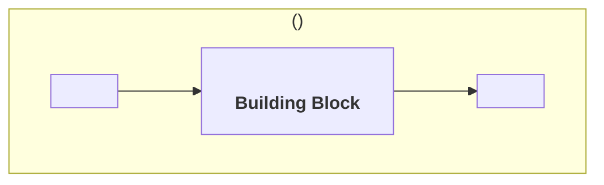

<!--
How to fill this file: see the Specification Framework, chapter "Introductory Chapters" (chapters/introductory_chapters.md), section "Purpose". A complete worked example is in resources/examples/wallet/introduction/purpose.md of the same repository.

The Purpose is the first presentation of the specification, written for a general audience such as decision-makers and buyers. A reader who finishes it should know whether the Building Block addresses their need. Its content comes from the Working Group's preparatory work (resources/preparatory_work.md in the Specification Framework).

Replace every <placeholder> and delete every comment before publication. Do not write requirements, product names or vendor names in this file.
-->

# Purpose

## Value

<!--
Answer four questions in one to three paragraphs:
1. What problem does this Building Block solve, and for whom?
2. What can a government do with it that it could not do before?
3. Which capabilities does it provide? Name each as a noun phrase ("Credential Storage", not "Stores credentials"), stating what, never how.
4. What would go wrong if every government and vendor built this component to their own design? Use one or more of: interoperability, replaceability, choice, assurance.

Declare every capability named here in metadata.yml, under capabilities, with the same title. Every capability must be realised by at least one functionality in technical_overview.md, through the realises field of the functionality's file. When a capability is realised only by an extension, say so: a reader must not assume every conformant solution provides it. If none of the four arguments in question 4 applies, the component may not need a GovStack specification.
-->

The <Building Block name> Building Block exists so that <beneficiary> can <outcome>.

Today <the problem, stated plainly>. The <Building Block name> provides **<Capability>**, **<Capability>** and **<Capability>**, so that <the changed state>.

A common specification matters here because <the interoperability, replaceability, choice or assurance argument, specific to this Building Block>.

## Place in larger systems

<!--
Place the Building Block in the systems it operates in. Name roles, not products. Place the reference architecture for the reader; do not import its content.

- The GovStack Architecture, and the cross-functional requirements the Building Block inherits
- Each Domain Reference Architecture in which it performs a role, and the role. If none exists for the domain, say so and describe the domain context in the Building Block's own terms
- Which part of this specification performs each role. The obligations towards a role are in this specification, never in the reference architecture. When they are in an extension, say that only a solution claiming the extension performs the role in full
- The other roles in those systems, and which of them it exchanges information with
- The Building Blocks it commonly works with, and for what
- Whether it is a foundational or a feature Building Block, when that helps the reader
-->

The <Building Block name> operates within the GovStack Architecture, and every conformant solution meets the GovStack cross-functional requirements.

In the <Domain Reference Architecture name> (`<govstack:ra:identifier>`) the <Building Block name> performs the **<role>** role. <The other roles in that system, what each does, and which of them exchange information with this Building Block.>

The <Building Block name> is a <foundational | feature> Building Block. It commonly works with:

- the **<Building Block>** Building Block, <for what>;
- the **<Building Block>** Building Block, <for what>.

<!-- Context diagram: the Building Block as one role among the others, with the main exchanges. Draw roles, not deployments, and keep the Building Block's internals out. Draw one diagram per Domain Reference Architecture. -->

*Figure 1: the <Building Block name> in the <role> role.*
