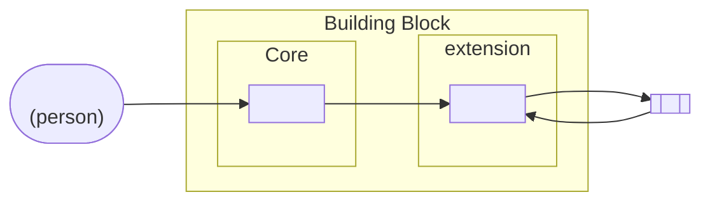

<!--
How to fill this file: see the Specification Framework, chapter "Introductory Chapters" (chapters/introductory_chapters.md), section "Technical Overview". A complete worked example is in resources/examples/wallet/introduction/technical_overview.md of the same repository.

The Technical Overview is written for teams that build, implement or assess a solution. It identifies what a conformant solution is, before the requirements say what it must do. Market assessment and Functionalities are required; Actors and Interfaces are optional. When the optional sections are present, the diagrams and tables must agree: every actor in the functionality map appears in the actor table, and every arrow crossing the boundary appears in the interface table.

Replace every <placeholder> and delete every comment before publication. Do not write requirements, product names or vendor names in this file.
-->

# Technical Overview

## Market assessment

<!--
Explain what the Working Group surveyed before choosing the functionalities, and how the survey led to them. The material comes from "Groundwork reading" in the preparatory work. One to four paragraphs, and a table of sources when there are more than a few.

- The state of the art: the kinds of systems that already do what the Building Block does, in country implementations, open-source projects and products, and how mature the field is
- The systems, standards and protocols examined, and what each contributed. Naming protocols and standards is fine. Describe products by category rather than by name
- Why the survey led to this set of functionalities: what the surveyed systems have in common, which differences matter for interoperability, and what was considered and left out. Whatever was left out and has an owner reappears in "Not covered" in scope.md
-->

The Working Group surveyed <the kinds of systems examined>. <What they have in common, and how they differ.>

It examined <standards and protocols>, which <what each contributed>.

<Why the survey led to the functionalities below.> <What was considered and left out, and where it belongs instead.>

## Functionalities

<!-- One row per functionality. Each has its own file in requirements/, and the name here matches that file's title exactly. Realises names the capabilities from Value in purpose.md that the functionality realises, by title, and matches the realises field of the file. Description repeats the description field of the file. Conformance is "Core", or "<Extension> extension", and matches the conformance and extension fields of the file. See the Specification Framework, chapter "Functionalities and Extensions". -->

| Functionality | Realises | Conformance | Description | Requirements |
|---|---|---|---|---|
| <Functionality name> | <Capability> | Core | <One sentence> | `requirements/<functionality-name>.md` |
| <Functionality name> | <Capability>, <Capability> | <Extension> extension | <One sentence> | `requirements/<functionality-name>.md` |

<!-- Explain how the functionalities divide the capabilities. Where several functionalities realise one capability, say how they divide it, and when some of them are in an extension, what a solution claiming it provides beyond the core. Why these functionalities were chosen is already in the Market assessment; do not repeat it here. -->

<Capability> is realised by <Functionality name> and <Functionality name>, which <how they divide it>. <What a solution claiming an extension adds to the capability, if any.>

### Core and extensions

<!--
If the specification has no extensions, replace this section with one sentence: "Every functionality is part of the core." and delete the table.

Otherwise:
- Explain the core first, and why it stands alone: what a solution that meets only the core can do, and why that makes it an instance of the Building Block
- One row per extension, matching the extensions declared in metadata.yml, with the same titles
- Adds: what a solution claiming the extension can do that the core alone cannot. Write it for a buyer deciding whether to require it
- Role served: the role the Building Block performs through the extension, and the Domain Reference Architecture that describes it. Leave empty if none
- Requires: other extensions a solution must also claim
- Explain why each extension is not core: some conformant products legitimately lack it, it is an obligation towards a domain role not every deployment has, or it depends on infrastructure not every deployment has
- Say which combinations you expect buyers to ask for
-->

The core is <what a solution that meets only the core can do, and why that is enough to make it an instance of the Building Block>.

| Extension | Adds | Functionalities | Role served | Requires |
|---|---|---|---|---|
| <Extension> | <What a solution claiming it can do that the core alone cannot> | <Functionality name> | <role>, towards <role>, in `<govstack:ra:identifier>` | <Extension, or empty> |

<Why each extension is not core, and which combinations buyers are expected to ask for.>

<!-- Functionality map: functionalities inside the boundary, actors outside it, and how each actor reaches each functionality. Draw each extension as a group inside the boundary; without extensions, drop the groups. A functionality no actor reaches, directly or through another functionality, is probably an internal mechanism. -->

*Figure 1: functionality map of the <Building Block name> Building Block.*

## Actors (optional)

<!--
Include this section when the functionality map alone does not make clear who the Building Block deals with, or where each actor's behaviour is specified. Otherwise delete it.

List every actor the Building Block interacts with: people, organisations, other systems and other Building Blocks.

- Specified where: the publication that defines the actor's behaviour (a Domain Reference Architecture, another Building Block specification, an external standard, or "Not specified"). An actor outside the boundary is never specified by this document, only its interface with the Building Block
- Use the role names of the Domain Reference Architecture where one exists
- Every actor marked Outside reappears in "Not covered" in scope.md, with its owner
- When an actor reaches the Building Block only through an extension, name the extension: "<Functionality name> (<Extension> extension)"
-->

| Actor | Kind | Boundary | Reaches the Building Block through | Specified where |
|---|---|---|---|---|
| <Actor> | <Person \| Organisation \| System \| Building Block> | <Inside \| Outside> | <Functionality name> | <`govstack:...` \| external standard \| Not specified> |

## Interfaces (optional)

<!--
Include this section when a reader needs one place that lists every exchange crossing the boundary of the Building Block. Each requirement already records its interaction type, so this table summarises the requirements; it is not a second source of truth. Otherwise delete it.

List every interface that crosses the boundary of the Building Block.

- Type: Service API, Consumed API, Protocol, Event, User interface, Device or File
- Every interface listed is realised by at least one requirement whose interaction field matches its type (SERVICE_API, CONSUMED_API, PROTOCOL, EVENT, USER_INTERFACE, DEVICE, FILE), and every requirement that is not INTERNAL realises an interface listed here
- Do not list interfaces inherited from the cross-functional requirements (logging, monitoring, deployment), unless this Building Block adds to the inherited contract
- Record the logical counterpart, not the Information Mediator, unless the Building Block depends on a mediation feature specifically
- Name the contract, not the technology
- A protocol defined for a domain is usually realised by an extension functionality. If a core functionality realises it, explain in "Core and extensions" why every conformant solution needs it
-->

| Interface | Counterpart | Direction | Functionality | Type | Contract defined in |
|---|---|---|---|---|---|
| <Interface name> | <Actor> | <Inbound \| Outbound \| both, described> | <Functionality name> | <Type> | <This specification, `resources/api/...` \| `govstack:...` \| external standard> |
